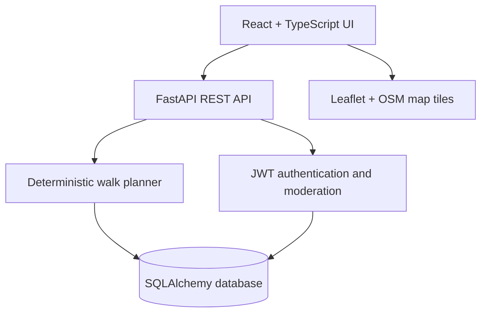

# Virasat — Heritage, Rediscovered

Virasat is a prototype constraint-aware walk planner for Ahmedabad's historic core, built for HackCult '26 (Culture & Digital Heritage). Visitors select a starting point, time budget and interests; the backend recommends a route, explains its choices and can replan after visited/skipped stops. Signed-in users can propose heritage locations for moderator review.

> **Demo caveat:** This is a working prototype, not a verified pedestrian-navigation or guaranteed opening-hours service. The small bundled site dataset needs independent accuracy review; see [HERITAGE_DATA_AUDIT.md](HERITAGE_DATA_AUDIT.md).

## Architecture



The planner filters approved sites within the historic core, estimates walking durations conservatively, evaluates opening schedules/restrictions when known, and selects time-budget-feasible stops using an explainable greedy score. The heuristic does **not** guarantee an optimal route; map polylines connect site coordinates rather than follow real walkable streets.

## Database

Ten ORM tables: `city`, `site`, `site_schedule`, `site_source`, `site_restriction`, `user`, `route`, `route_share`, `submission`, `problem_report`. Foreign keys associate sites with cities/schedules/sources, submissions with users and approved sites, and routes with owners/shared users. The app uses SQLite for the bundled demo; the database URL is configurable for a deployed SQL service.

## Run the app locally

Install Python 3.11+ and Node.js with npm. Run these commands from the extracted `virasat` directory in separate terminals.

```bash
cd backend
python -m venv .venv
.venv/bin/pip install -r requirements.txt
.venv/bin/python -m db.seed_heritage
.venv/bin/uvicorn main:app --host 127.0.0.1 --port 8000
```

On Windows, activate `.venv` and invoke `python -m uvicorn main:app --port 8000` instead.

```bash
cd frontend
npm ci
npm start
```

The frontend runs at `http://localhost:3000` and calls `http://localhost:8000` by default.

## Environment and deployment

- Backend: set `VIRASAT_DATABASE_URL`, a strong persistent `VIRASAT_SECRET_KEY`, and `VIRASAT_CORS_ORIGINS` (comma-separated exact frontend origins).
- Frontend: set `REACT_APP_API_BASE_URL` to the publicly reachable backend URL **before building**.
- Frontend production bundle: `cd frontend && npm run build`.
- Host frontend and backend behind HTTPS, provision a persistent SQL database and backups, and add a secure administrative process for moderator account assignment. Public users cannot self-assign moderator roles.
- Never publish sample test credentials, private JWT secrets, or site data labelled verified without checking the sources.

For step-by-step Netlify, Render and PostgreSQL configuration, see [DEPLOYMENT.md](DEPLOYMENT.md).

The starter catalog now includes **29 source-labelled historic-core candidates**. Run `python -m db.seed_heritage` to create the demo database or initialize PostgreSQL; local SQLite files are deliberately excluded from published source archives because older Arena exports may contain user records. Coordinates from Wikimedia/Wikidata references carry low confidence pending field review. Schedules remain unverified and no fake hours are inserted.

## API highlights

- `GET /health`, `GET /sites`, `GET /sites/{id}`
- `POST /plans`, `POST /plans/replan`
- `POST /auth/register`, `POST /auth/login`, `GET /auth/me`
- `POST /submissions`, `GET /submissions/mine`
- `GET /moderation/queue`, `POST /moderation/{id}/decision` (moderators only)

Swagger documentation: `http://localhost:8000/docs`.

## Tests and delivery

```bash
cd backend
.venv/bin/python -m pytest -q tests
```

The API suite tests auth boundaries, schedule restrictions, category filtering, time budgets, replanning, and 100 varying planning scenarios for determinism and feasibility. It does not establish superiority over a baseline optimizer. Consult `REPAIR_STATUS.md` for known limitations and remaining acceptance work. A hackathon submission still needs a deployed live demo, recorded walkthrough, and a pitch deck, all tested against the actual deployment.
